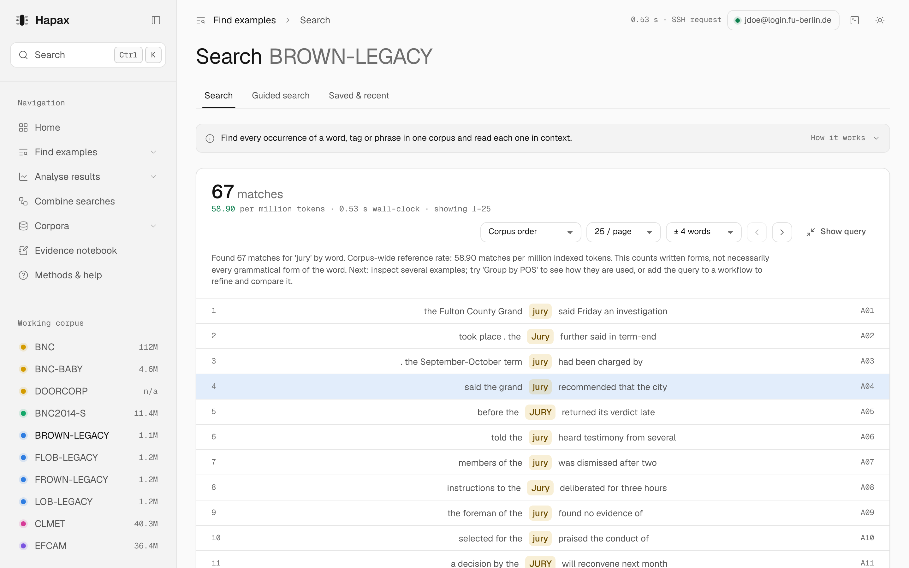
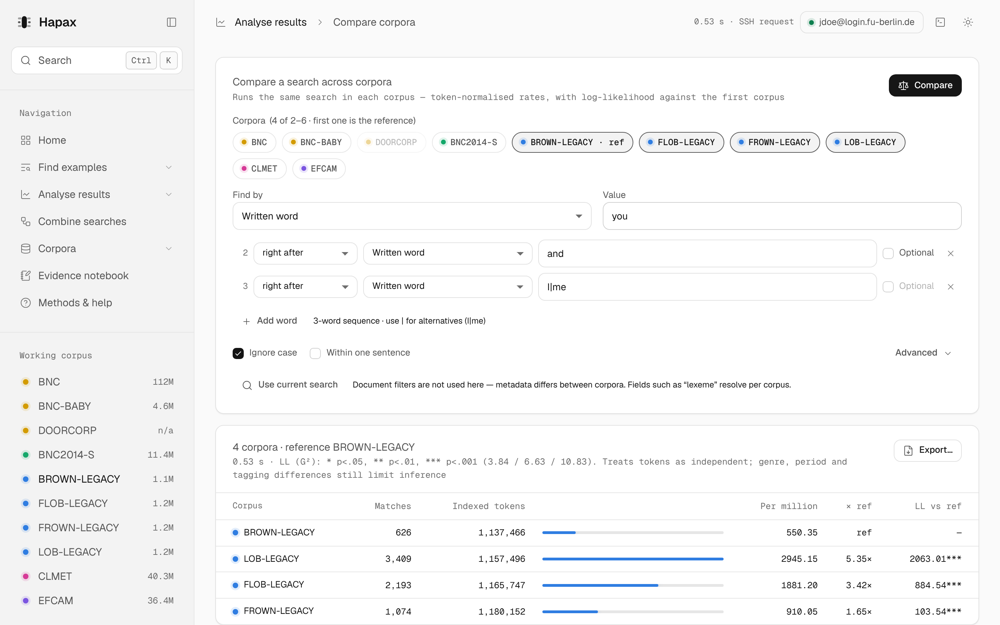

# Hapax

<picture>
  <source media="(prefers-color-scheme: dark)" srcset="docs/images/search-dark.png">
  
</picture>

[](https://github.com/Versuessen/hapax/releases/latest)
[](https://github.com/Versuessen/hapax/actions/workflows/release.yml)
[](#install)
[](LICENSE)

A desktop app for searching and analysing CWB/CQP corpora over SSH, without writing CQP.

Hapax connects to a corpus server with your own SSH login and runs the
[IMS Open Corpus Workbench](https://cwb.sourceforge.io/) (CWB) for you. You describe what to
find — a word, a tag, a phrase with alternatives — and Hapax builds a validated CQP query,
runs it on the server, and shows the result as a concordance, frequency table, distribution or
cross-corpus comparison. It never writes to the server.

The name comes from *hapax legomenon*: a word that occurs only once in a corpus.

> **Scope.** Hapax is configured for the CWB corpus installation reached through
> `login.fu-berlin.de` at Freie Universität Berlin (CWB 3.5). It can work with other CWB servers, but
> paths are currently set in the source — see [Using another server](#using-another-server).

## Contents

- [Features](#features)
- [Install](#install)
- [Usage](#usage)
- [How it works](#how-it-works)
- [Using another server](#using-another-server)
- [Development](#development)
- [Releasing](#releasing)
- [Contributing](#contributing)
- [Acknowledgements](#acknowledgements)
- [License](#license)

## Features

**Find examples**
- Search by written word, all forms of a word (lexeme), part-of-speech tag or any other
  annotation the corpus has.
- **Filters** on any document or speaker metadata, combined with AND: only spoken texts, only
  female speakers, only texts from 1990–1994, or all three at once.
- **All forms of a word** — exact through the lemma index where a corpus has one, and through
  reviewed, rule-based suggestions (big → bigger, biggest) where it does not.
- Phrases of up to nine words. Each word can follow directly or within *N* words, can be
  optional, and can list alternatives: `you` → `and` → `I|me`.
- Sort the whole result on the server by the match, the word before or the word after.
- Guided search builds a query from a plain-language question, translating categories such
  as “noun” into each corpus's own tagset.

**Analyse results**
- **Count by annotation:** break every match down by POS, lemma or word form — counting any word
  of a phrase or the whole matched phrase, in one corpus or several side by side, each with its
  own filters.
- **Nearby words:** positional counts four words either side.
- **Spread across texts:** matches per genre, period, speaker or file, each normalised by that
  group's own size. Brown-family file ids roll up into the A–R genre categories.
- **Compare corpora:** run one search in two to six corpora or filtered parts of them, with
  per-million rates (against the filtered size) and log-likelihood against a reference.
- **Combine searches:** refine results and join them with union, intersection or difference.

<picture>
  <source media="(prefers-color-scheme: dark)" srcset="docs/images/compare-dark.png">
  
</picture>

**Work reproducibly**
- Every query is shown as the exact CQP that runs on the server, and can be copied as commands
  for your own SSH terminal (`cqp>` prompt or a shell script).
- Concordance, workflow and comparison exports (CSV/TSV) come with a `_provenance.json`
  recording the query, corpus and date.
- An evidence notebook keeps judged examples (relevant, irrelevant, unsure) with notes.
- A request console (<kbd>Ctrl</kbd>+<kbd>`</kbd>) logs every command sent and every reply.

**Stay current**
- Corpora are grouped by language variety (British, American, learner English, …) and flagged,
  so you can see at a glance what you are comparing.
- The list of corpora is read from the server's registry on every connect. New corpora appear,
  removed ones are marked offline, and a fixed registry charset is picked up automatically.
- Hapax updates itself from signed GitHub releases.

Each screen opens with a short guide explaining what it is for and how to use it.
*Screenshots use the built-in sample data, not real corpus counts.*

## Install

Download the installer for your system from the
[latest release](https://github.com/Versuessen/hapax/releases/latest).

| System | File | Install |
|---|---|---|
| Windows 10/11 (x64) | `Hapax_<version>_x64-setup.exe` | Run it. Windows SmartScreen may warn because the installer is not code-signed; choose *More info → Run anyway*. |
| Fedora, RHEL, openSUSE | `Hapax-<version>-1.x86_64.rpm` | `sudo dnf install ./Hapax-*.rpm` |
| Debian, Ubuntu, Mint | `Hapax_<version>_amd64.deb` | `sudo apt install ./Hapax_*.deb` |
| Other Linux | `Hapax_<version>_amd64.AppImage` | `chmod +x Hapax_*.AppImage && ./Hapax_*.AppImage` |

**Updates are automatic.** At start-up Hapax checks for a newer release, shows what changed, and
installs it when you choose *Install and restart*. Each download is verified against a signing
key built into the app. On Linux the package manager asks for your password.

### Requirements

- A user account on a server that runs CWB 3.x and Python 3, reachable over SSH.
- Linux: WebKitGTK 4.1 (installed automatically with the `.rpm`/`.deb`).
- Windows: WebView2 (included in Windows 11; the installer fetches it on Windows 10).

## Usage

1. **Connect.** Select the connection status in the top bar, enter your university username
   and password, and confirm the server's host key the first time. You can store the password
   in your system keychain (Windows Credential Manager, KWallet or GNOME Keyring).
2. **Choose a corpus** under *Working corpus* in the sidebar (on narrower windows, with the corpus
   switcher in the top bar).
3. **Search.** In *Find examples → Search*, choose what to match and type a value. Select
   *Add word* to search for a phrase. Press <kbd>Ctrl</kbd>+<kbd>Enter</kbd>.
4. **Analyse.** The *Analyse results* screens work on your current search.

### Example: *you and I* or *you and me*?

To see how often each variant appears in British and American English of the 1960s and 1990s:

1. In *Search*, set *Value* to `you`, then *Add word* → `and`, *Add word* → `I|me`, and tick
   *Ignore case*.
2. Open *Analyse results → Compare corpora*, select *Use current search*, and select
   BROWN-LEGACY, LOB-LEGACY, FROWN-LEGACY and FLOB-LEGACY.
3. Select *Compare*. To split *I* from *me*, open *Count by annotation*, group by *Written word*
   and count the *Last token*.

The same search, copied from *Query* (under the search form) as *cqp> prompt*:

```
BROWN-LEGACY;
Hits = [word="you" %c] [word="and" %c] [word="(I|me)" %c];
size Hits;
group Hits matchend word;
```

### Keyboard shortcuts

| Keys | Action |
|---|---|
| <kbd>Ctrl</kbd>+<kbd>K</kbd> | Go to a screen, corpus, saved or recent search |
| <kbd>Ctrl</kbd>+<kbd>Enter</kbd> | Run the current search |
| <kbd>Ctrl</kbd>+<kbd>S</kbd> | Save the current search |
| <kbd>Alt</kbd>+<kbd>1</kbd>…<kbd>7</kbd> | Go to a section |
| <kbd>Ctrl</kbd>+<kbd>`</kbd> | Show or hide the request console |
| <kbd>F1</kbd> | Methods & help |

*Methods & help* in the app explains how every figure is calculated. Read it before citing a
count or a rate.

## How it works

```
┌──────────── Hapax (your computer) ─────────────┐          ┌────── corpus server ──────┐
│ React UI ──IPC──▶ Rust core                    │   SSH    │ python3 -c <worker.py>     │
│                   ├ query compiler (allow-list)│ ───────▶ │   ├ cqp -c -r <registry>   │
│                   ├ SSH client (russh)         │  stdin:  │   ├ cwb-describe-corpus    │
│                   ├ result parser & cache      │  JSON    │   ├ cwb-lexdecode / -decode│
│                   └ keychain, exports, updater │ ◀─────── │   └ collocates.pl          │
└────────────────────────────────────────────────┘  stdout: └────────────────────────────┘
                                                     JSON
```

- **No raw CQP from the user.** The interface sends a structured request. The Rust core checks
  every field against the corpus inventory and an allow-list, escapes literal values, and only
  then writes the CQP expression.
- **Read-only.** Each request starts a short-lived worker script over SSH, with the request as
  JSON on standard input. The worker runs CWB's read-only tools and nothing else; nothing is
  installed or stored on the server.
- **Host keys are verified** against `~/.ssh/known_hosts`. Unknown keys need your confirmation;
  changed keys are refused.
- **Passwords** are kept only in the operating system's keychain, never in files or logs.

See [docs/architecture.md](docs/architecture.md) for the module map, IPC contract and limits.

## Using another server

The server-specific values live in four places:

| Value | Where |
|---|---|
| Default SSH host | `DEFAULT_HOST` in `src-tauri/src/storage.rs` |
| CWB installation and registry | `ROOT`, `REG` in `src-tauri/remote/worker.py`; `CWB_REGISTRY` in `src-tauri/src/corpora.rs`; `CWB_ROOT` in `src-tauri/src/terminal.rs`; `CWB_BIN` in `src-tauri/src/console.rs` |
| Collocates script | `src-tauri/remote/worker.py`, `src-tauri/src/terminal.rs` |
| Hand-verified corpus descriptions | `src-tauri/resources/corpora.json` (optional — other corpora are discovered from the registry) |

Corpora that are not in `corpora.json` still work: their size and attributes are read from the
registry when you connect, and they are labelled *found on the server*.

## Development

**Prerequisites:** Rust 1.89+, Node.js 20+, and the Tauri system libraries.

```sh
# Fedora
sudo dnf install webkit2gtk4.1-devel gtk3-devel libsoup3-devel librsvg2-devel openssl-devel gcc
# Debian/Ubuntu
sudo apt install libwebkit2gtk-4.1-dev libappindicator3-dev librsvg2-dev patchelf libssl-dev
# Windows: Visual Studio Build Tools with “Desktop development with C++”
```

```sh
git clone https://github.com/Versuessen/hapax.git
cd hapax
npm install
npm run tauri dev          # the desktop app, against a real server
npm run dev                # browser preview with sample data: http://localhost:1420/?fixtures=1
```

Sample-data options for the browser preview: `?fixtures=offline` (start disconnected),
`&hostkey=1` (host-key prompt), `&registry=changed` (a corpus removed and one added),
`&update=1` (an available update). The sample backend exists only in development builds.

### Tests

```sh
cargo test --manifest-path src-tauri/Cargo.toml        # query compiler, parsers, discovery, storage
npm run build                                          # builds the interface

# End-to-end over SSH, against any server with CWB (or a local sshd with stub tools):
CQP_TEST_SSH_HOST=… CQP_TEST_SSH_USER=… CQP_TEST_SSH_PASSWORD=… \
  cargo test --manifest-path src-tauri/Cargo.toml --test live_ssh -- --nocapture
```

### Project layout

```
src/                     React interface
  screens/               one file per section
  components/            shared UI: query builder, page header + guide, console, dialogs
  guides.js              the in-app guide text for every screen
  dev/fixtures.js        sample backend for the browser preview (dev builds only)
src-tauri/
  src/query.rs           structured query → CQP, validation
  src/corpora.rs         corpus inventory and registry discovery
  src/ssh.rs             SSH client and host-key handling
  src/commands.rs        IPC commands
  remote/worker.py       the script run on the server
  resources/             verified corpus metadata and tagset codebook
scripts/                 release helpers
docs/                    architecture, release process, design principles
```

## Releasing

Every push to `main` runs the tests, builds signed installers for Windows and Linux, and
publishes them as a GitHub release. Installed copies pick the release up on their next start.
Version numbers are `<major>.<minor>` from `src-tauri/tauri.conf.json` plus the build number.
Setup and details: [docs/releasing.md](docs/releasing.md).

## Contributing

Bug reports and suggestions are welcome as
[issues](https://github.com/Versuessen/hapax/issues). For a corpus or query problem, include the
corpus, what you searched for, and the console entry (<kbd>Ctrl</kbd>+<kbd>`</kbd> → select the
request → copy) — it contains the exact command and the server's reply, and never your
password. Pull requests: see [CONTRIBUTING.md](CONTRIBUTING.md).

## Acknowledgements

- [IMS Open Corpus Workbench](https://cwb.sourceforge.io/) by Stefan Evert, Andrew Hardie and
  contributors, which does the actual searching.
- [Tauri](https://tauri.app/), [russh](https://github.com/Eugeny/russh),
  [React](https://react.dev/), [Lucide](https://lucide.dev/) icons and the
  [Geist](https://vercel.com/font) typefaces.
- The corpora belong to their compilers and are licensed for research and teaching through the
  university. Hapax does not include or redistribute any corpus data; follow each corpus's
  licence before sharing exports, especially learner and speaker metadata.

## License

[MIT](LICENSE) © 2026 Jonas Bluhm
