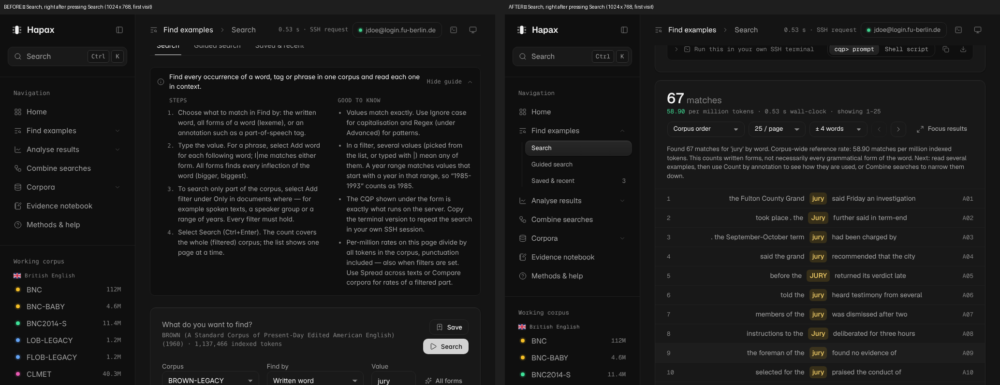
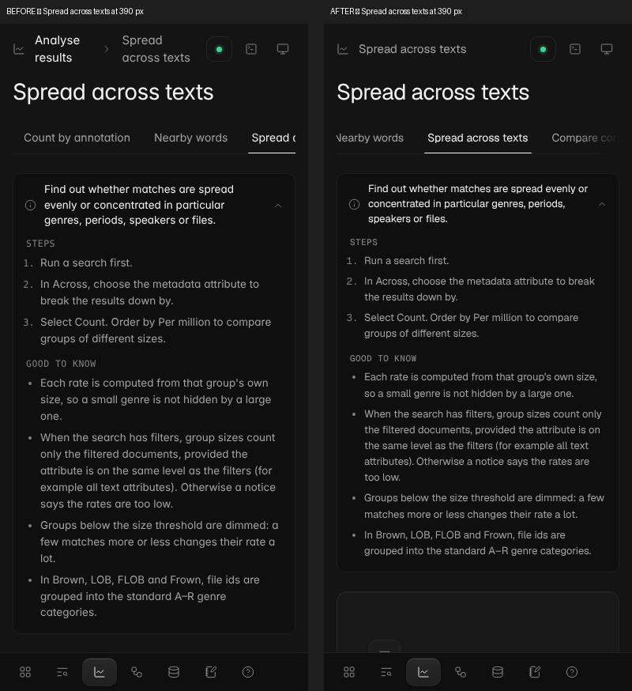

# Hapax — product and UX audit (November 2026)

Mode: audit and implement. Low-risk improvements were implemented and verified in this pass;
structural changes are proposed below and await approval.

Evidence base: the app rendered with its sample backend (`?fixtures=1`), Playwright scripts, and
source inspection. Every screen was captured in a realistic state (search run, analyses counted,
evidence added) in dark and light at 1440 × 900, and in dark at 1024 × 768 and 390 × 844:
14 screens, 58 captures. Measurements come from computed styles in the browser. Accessibility was
checked with axe-core 4 (WCAG 2.0/2.1/2.2 A and AA plus best practices) on every screen in both themes.
Scores are expert judgements anchored to those observations, not user research.

---

## A. Executive assessment

Hapax is a capable, honest research tool: the query model is precise, every number states its basis,
and the generated CQP is always visible. Its weaknesses were not in features but in **how much the
interface asked before it showed results**:

- **Results were never visible after searching.** On every viewport, the first concordance line sat
  below the fold (y = 1,196–1,916 px in a 768–900 px window), behind the open guide, the form, the
  CQP preview and an always-expanded terminal block.
- **Guides opened on every screen, for every user, forever.** They pushed the main task down by
  290–360 px. That is right on a first visit and wrong on the hundredth.
- **The rename left three silent regressions:** Ctrl+S and Ctrl+E did nothing; picking a corpus
  from Home or Corpora jumped to Search; the sidebar never unfolded the current section.
- **Small-screen header** wrapped onto two lines, the page qualifier wrapped onto three at 32 px,
  and the section tabs were clipped without any sign that they scroll.
- **Design-system drift:** 15 font sizes in use (the token scale defines 10), 12 px hard-coded in
  46 places, and card padding of 15, 17, 18 and 24 px from optical tweaks copied from a reference.
- **68 axe violations** across 5 rules, chiefly accessible names that did not contain the visible
  label.

Strengths to keep: task-ordered navigation, the per-screen purpose line, the honest notes on how
rates are computed, the console, consistent controls (all buttons 32 px / radius 10, inputs 40 px),
no horizontal overflow at any size, clear error messages from the query compiler.

**Direction:** keep the product's density and precision; let the interface get out of the way for
returning users (progressive disclosure that learns), and keep the current task — usually *results*
— in view.

## B. Coverage

| Area | Status |
|---|---|
| 14 screens, dark + light, desktop | Fully inspected (screenshots, metrics, axe) |
| 14 screens, dark, tablet 1024 and mobile 390 | Fully inspected (screenshots, metrics) |
| Search → analyse → compare → evidence workflow | Fully inspected (scripted, measured) |
| Filters, multi-word search, all-forms helper, phrase counts | Fully inspected (scripted) |
| Connect dialog, host-key dialog, palette, console | Partially (existing regression suite: focus trap, Esc, palette keyboard) |
| Update notice | Partially (sample update via `?update=1`) |
| Real server responses, latency, large results | Not accessible here (sample backend) |
| Windows rendering (WebView2), KDE scaling | Not accessible here |
| Screen-reader walkthrough | Inferred from axe and markup; no live screen reader |

## C. Scores

Weights as specified. 0–10 per dimension; weighted overall 0–100.

| Dimension (weight) | Before | After | Evidence |
|---|---:|---:|---|
| Functional clarity (15) | 7.5 | 8.0 | Purpose line per screen; result visible after search |
| Workflow efficiency (15) | 5.5 | 7.0 | First result above fold 0/6 → 6/6 cases; section change 2 clicks → 1 |
| Information architecture (12) | 7.5 | 7.5 | Task-ordered; proposals P3 pending |
| Interaction usability (12) | 6.5 | 7.5 | 3 broken behaviours fixed |
| Visual hierarchy (10) | 6.5 | 7.5 | Guide/terminal no longer dominate the first screen |
| Consistency (10) | 6.5 | 7.5 | Font sizes 15 → 12; card paddings 4 variants → 2 |
| Accessibility (10) | 7.0 | 9.0 | axe: 68 nodes → 0; scroll regions keyboard-reachable |
| Learnability & confidence (8) | 8.0 | 8.5 | Guides stay for beginners; reset available |
| Information communication (5) | 8.0 | 8.5 | "00" zero-padding removed from counts |
| Responsive adaptability (3) | 6.0 | 7.5 | One-line header, readable qualifier, tab affordance |
| **Overall** | **68.5** | **77.8** | |

Per workflow (after): first search 8/10; analyse a search 8/10; compare filtered parts 7/10
(still needs per-corpus filter setup); evidence review 8/10; multi-step workflow 7/10.

## D. Issue register

Priority = (Impact × Frequency × Confidence) / Effort, used for ranking only.

| ID | Location | Problem and evidence | Change | Sev. | Conf. | Effort | Prio | Status |
|---|---|---|---|---|---|---|---|---|
| U1 | Search | First result below fold in 6/6 measured cases (y 1,196–1,916) | Scroll fresh results into view after render; form stays one scroll up | High | High | Low | 20.0 | Implemented |
| U2 | All screens, `PageHeader.jsx` | Guide open by default for everyone; form starts at y 655 (1440) / 739 (1024) | Guides open on first visits until the user hides any guide; then closed by default. "Show all guides again" in Methods & help | High | High | Low | 20.0 | Implemented |
| U3 | Search, Combine, `TerminalBlock.jsx` | Terminal commands always expanded (≈200 px) though used occasionally | Collapsed disclosure, state remembered; always open in the console | Med | High | Low | 12.0 | Implemented |
| B1 | `App.jsx` shortcuts | Ctrl+S / Ctrl+E checked the old id `search` → never fired | Use `find/search` | High | High | Low | 15.0 | Implemented |
| B2 | `Sidebar.jsx` | Picking a corpus compared old ids → always jumped to Search | Stay on corpus-related screens | Med | High | Low | 9.0 | Implemented |
| B3 | `Sidebar.jsx` | Section auto-unfold keyed on old ids → never unfolded | Derive from NAV | Med | High | Low | 9.0 | Implemented |
| W1 | Sidebar | Section label only unfolded; reaching a screen took 2 clicks | Section label goes to the last page used in that section and unfolds it; folds when already inside | Med | High | Low | 12.0 | Implemented |
| W2 | Compare | Preselected Brown + LOB and a default "jury" regardless of the user's work; user had to deselect | Start from the current search, its corpus as reference, its filters on that corpus | Med | High | Low | 9.0 | Implemented |
| A1 | Sidebar search, status pill | `label-content-name-mismatch` (56 nodes) | Names begin with the visible text (sr-only suffix) | High | High | Low | 10.0 | Implemented |
| A2 | Tables in cards | `scrollable-region-focusable` (6) | `tabIndex=0`, `role=region`, unique labels | High | High | Low | 8.0 | Implemented |
| A3 | Tables | `empty-table-header` (2) | sr-only header text | Low | High | Low | 4.0 | Implemented |
| A4 | Help links | `link-in-text-block` (2): colour only, 1.01:1 vs text | Underline links in running text | Med | High | Low | 6.0 | Implemented |
| A5 | Light theme | `--warning` text 3.94:1; links 4.08:1 | `--warning #8f6600` (5.2:1), `--link #1d67c9` (5.5:1) | Med | High | Low | 6.0 | Implemented |
| D1 | Tokens | 15 font sizes; 12 px hard-coded ×46; 11.5 / 13.5 off-scale | Snap to `--fs-*` tokens (12 sizes remain, all tokenised or deliberate) | Low | High | Low | 5.0 | Implemented |
| D2 | `.stat`, `.chart-card`, corpus tiles | Paddings 15/17/18 px (optical copies) | `--space-4` (16) / `--space-6` (24) | Low | High | Low | 5.0 | Implemented |
| D3 | Home, Evidence | Counts zero-padded ("00 / 25") — decorative, reads as a code | Plain numbers | Low | High | Low | 5.0 | Implemented |
| R1 | Topbar < 560 px | Breadcrumb wrapped to 2 lines | Show only the current page; tabs name the section | Med | High | Low | 6.0 | Implemented |
| R2 | Page title < 560 px | Qualifier wrapped to 3 lines at 32 px | Own line at 18 px | Low | High | Low | 4.0 | Implemented |
| R3 | Section tabs < 760 px | Clipped with no cue; selected tab could be off-screen | Edge fade; selected tab scrolled into view | Med | High | Low | 6.0 | Implemented |
| H1 | Methods & help | Guide panel on a page that is itself the guide | Removed there | Low | High | Low | 3.0 | Implemented |
| P1–P5 | see E | Structural | see E | — | Med | Med–High | — | Implemented (approved) |

## E. Restructuring proposals (approved and implemented)

| ID | Proposal | Why | Trade-off | As built |
|---|---|---|---|---|
| P1 | **Two-column Search**: form left (sticky, scrolls independently), results right | Query and results visible together; refine-and-rerun without scrolling (the commonest loop) | Narrower concordance lines | Container query on the page: two columns from 1040 px of *content* width (1440 window with sidebar, 1280 with the rail, any width ≤ 1100 with the rail from P4). Editing the query moves results 93 px (the stale notice) instead of re-flowing the page. `1776c52` |
| P2 | **Home as "continue"**: replace the large Nearby-words chart with last search (rerun / analyse), recent searches and evidence status | The chart duplicates *Nearby words* and only fills after a search; a returning user's first need is to resume | The chart is visually striking; it remains on its own screen | Three states: *Current search* (Show results, Count, Spread, Compare), *Continue where you left off* (Run again, Edit, New search) and, on first run, *Start* (three ways in). Recent and saved searches beside it, one click to load. `a1cb105` |
| P3 | **Corpora → Contents as a table** (variety, size, annotation, status, description) instead of 11 cards | Cards repeat the sidebar list; a table is denser, sortable, and comparable | Less visual; descriptions drop out on narrow windows | Sortable headings with `aria-sort`; status words (Searchable, Not searchable, Offline, Unverified) explain themselves on hover; description, annotation, metadata and variety columns drop out at 1100 / 820 / 560 px of content. `7a42c9b` |
| P4 | **Tablet (≤ 1100 px): sidebar as icon rail with a corpus switcher in the top bar** | Gives 216 px back at 1024 | The grouped corpus list is no longer always visible | The switcher appears whenever the sidebar is a rail, also when collapsed by hand at any width, and on phones, where the corpus list was previously unreachable. Grouped by variety, arrow keys, Esc returns focus. `a2bdccb` |
| P5 | **One "Query" disclosure** combining the CQP preview and terminal commands | Two adjacent boxes show the same query twice | Generated CQP is a trust feature; must stay one click away | Closed, the bar still shows the CQP on one line with Copy, so it is zero clicks away; open, it switches CQP / cqp> prompt / Shell script and saves to a file. Validation errors are never folded away. Single-column refine movement 509 → 393 px. `f64dfa2` |

Not recommended: merging Count / Nearby / Spread into one screen (different questions, different
controls; tabs already make them one click apart).

## F. Components and interactions

- **Keep:** the query builder model (words, alternatives, filters), Segmented controls for 2–3
  options, chips for corpus selection, the console, explicit Count/Compare buttons (server work is
  never implicit).
- **Changed:** `PageHeader` guide (learns), `TerminalBlock` (disclosure; shares its fetching with the
  new `QueryPanel`), `Sidebar` (one-click sections, correct state, rail ≤ 1100 px), `Topbar` (corpus
  switcher), `Card` (forwards refs for scroll targets), `Tabs` (keeps selection visible). `CqpPreview`
  was removed in favour of `QueryPanel`.
- **Next:** make filter rows reusable as saved presets ("BNC spoken 1990s") — removes the most
  repeated setup in the compare workflow.

## G. Visual specification

Type scale (all via tokens): display 34 · figure 32 / 30 · brand 18 · title/nav 15 · body 14 ·
small 13 · mono 12.5 · micro 11. Reading line in the KWIC detail: 16 (deliberate).
Spacing: 4-px base, `--space-1…9` = 4, 8, 12, 16, 20, 24, 32, 40, 48; cards 24, compact tiles and
stat cards 16 × 24. Radii: inputs/buttons 10, cards 12, dialogs 16, chips pill. Light-theme text
colours meet 4.5:1 for all text roles measured.

## H. Workflow comparisons

| Task | Before | After |
|---|---|---|
| See results after searching | Search + scroll ≈ 1–2 screens | Search (results scrolled into view) |
| Go to *Count by annotation* from the sidebar | 2 clicks (unfold, choose) | 1 click (returns to last page used in the section) |
| Compare the current search with one other corpus | Open Compare, deselect 2 defaults, *Use current search*, select corpus, Compare = 5 actions | Open Compare, select corpus, Compare = 3 actions |
| Save the current search with the keyboard | Ctrl+S did nothing | Ctrl+S opens Save |
| Pick a corpus while on Home or Corpora | Jumped to Search (context lost) | Stays on the page |
| Edit a search and rerun (1440 px) | Scroll up to the form, edit, Search, scroll down | Edit beside the results, Search; results stay in place |
| Resume yesterday's search | Find Saved & recent, Run | Home → Run again |
| Find the largest corpus with speaker metadata | Read 11 cards | Sort the table by Tokens or Metadata |
| Switch corpus at 1024 px | Sidebar dots without names (tooltips only) | Top-bar switcher with names and sizes |
| Copy the generated CQP | Select text in the preview box | Copy on the closed Query bar |

## I. Roadmap

1. **Done in the first pass:** U1–U3, B1–B3, W1–W2, A1–A5, D1–D3, R1–R3, H1.
2. **Done in the second pass (approved):** P1–P5, each committed and verified separately.
3. **Next — shared components:** filter presets; a `Table` component owning scroll region, sortable
   header (as in P3) and export.
4. **Re-audit:** see [ux-reaudit-2026-11.md](ux-reaudit-2026-11.md) for the verdicts on these changes and the QoL pass.
5. **Longer term:** usage telemetry kept local and opt-in, to replace judgement with measured task times.

## J. Implementation report

Files: `src/components/PageHeader.jsx`, `TerminalBlock.jsx`, `Sidebar.jsx`, `Topbar.jsx`, `ui.jsx`;
`src/screens/Search.jsx`, `Workflows.jsx`, `Overview.jsx`, `Evidence.jsx`, `Help.jsx`, `Corpus.jsx`,
`Analysis.jsx`, `Syntax.jsx`; `src/App.jsx`; `src/styles/tokens.css`, `base.css`, `components.css`,
`layout.css`. No backend change.

Verification: axe-core on 28 screen/theme combinations → 0 violations (from 68 nodes); regression
suite 18/18; IA suite all pass (Help now expects no guide); feature scripts (filters, counts,
compare, forms) pass; no console errors; no horizontal overflow at 390 / 1024 / 1440; position
measurements before/after in section H and in the commit.

Second pass (P1–P5): `Search.jsx`, `Overview.jsx`, `Corpus.jsx`, `Sidebar.jsx`, `Topbar.jsx`,
`TerminalBlock.jsx` (`QueryPanel`), `QueryBuilder.jsx`, `App.jsx`, `guides.js`, `layout.css`,
`components.css`. Each proposal has its own Playwright script (layout positions, sort order and
`aria-sort`, menu keyboard and focus return, panel persistence, error visibility) at 390, 1024, 1100,
1280, 1440 and 1920 px. After all five: axe-core 0 violations on 28 screen/theme combinations;
regression 18/18; IA suite all pass; filter and feature scripts pass; no console errors; no horizontal
overflow. The pass also removed an orphaned CSS block (left from the old card graphic) that made the
browser discard the `.field` rule after it.

Remaining risks: behaviour against the real server is unchanged but untested here; WebView2 and
KDE rendering of the type changes are unverified; the guide "learning" is per computer.

## K. Product direction

Hapax should feel like a precise instrument: everything it runs is visible, every number says what it
is divided by, and the screen you are on gives most of its space to the thing you are doing.
Beginners get the walkthrough once; returning users get density. New features follow four rules:
name the task, not the technique; never hide what runs on the server; put results where the eye
already is; and use a token for every size, space and colour.
