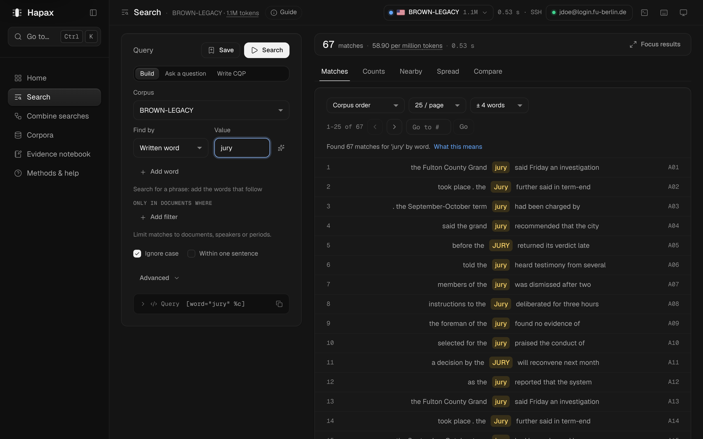
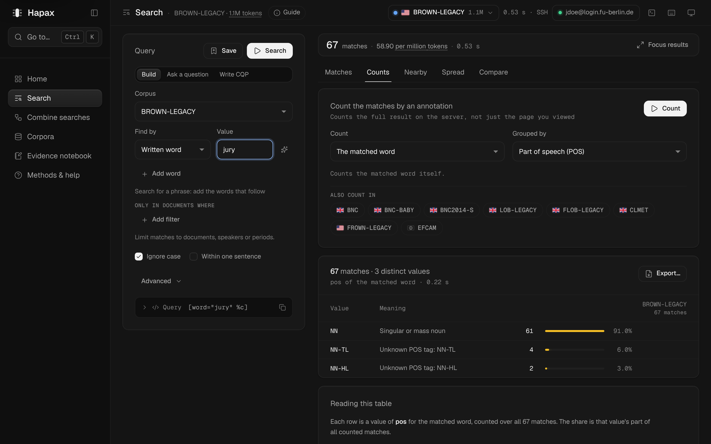
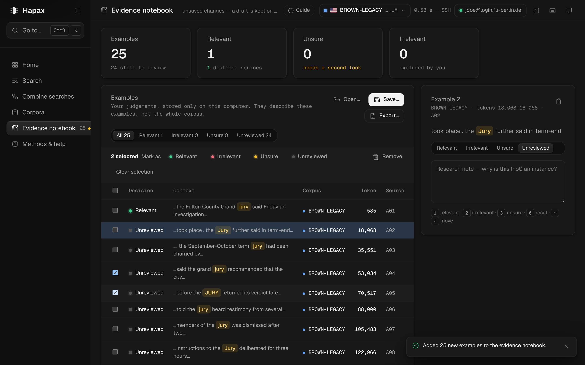

# UX overhaul — 03 Report

Date: 2026-11-11. Spec: `02-spec.md`. Audit and baseline: `01-audit.md`.
All numbers below were measured in the running app (fixture backend, Chromium via Playwright)
with the same counting rules before and after; scripts are listed at the end.

## 1. Summary

The frequent loop of corpus work — **write a query → read matches → count / spread / compare →
keep evidence** — now happens on one screen. Search is a workspace: the query panel stays on
the left; the result bar (total, rate, time, “results are from an earlier query”) and the views
**Matches · Counts · Nearby · Spread · Compare · Structure** sit on the right. Every view keeps
its result for the current search, so moving between them costs one key and loses nothing.

Around it the app became flatter and quieter:

* **Six destinations** instead of 7 sections, 9 sub-pages and tabs that repeated the sidebar.
* **One title** in the top bar (was: breadcrumb + 34 px title + tabs); page guides open on demand.
* **The working corpus** is picked in one place, the top-bar switcher, at every window size.
* **Guided search** is the “Ask a question” mode of the query panel; **Saved & recent** live on
  Home with Run, Load and Delete-with-Undo; **Tag reference** is Corpora › Tags.
* **One command registry** drives the palette (which now runs commands), every shortcut, a
  shortcut overview (`?`) and Help's table. 15 new shortcuts.
* **Evidence**: the review panel stays beside the table; tick several examples to mark or remove
  them together; arrow keys move.
* **Remembered**: last screen and views, page size, context, sort, count field, sample size,
  spread settings, compare corpora, Corpora selection, the Combine plan, the evidence filter.

Nothing was removed: all 63 ledger items are reachable (§5); 61 are checked by script, the other two (host-key dialog, resuming a refused run) are unchanged code.

## 2. Final information architecture

| Alt | Destination | Views / parts | Former locations |
|---|---|---|---|
| 1 | Home | Status, current/last search, all saved searches, all recent searches, this session | Home, Find examples › Saved & recent |
| 2 | Search | Query panel (Build · Ask a question · Write CQP); Matches · Counts · Nearby · Spread · Compare · Structure (Ctrl+1…6) | Find examples › Search, › Guided search; Analyse results › all five pages |
| 3 | Combine searches | Plan, run, results | Combine searches |
| 4 | Corpora | Table; About · Metadata · Tags | Corpora › Contents & metadata, › Tag reference |
| 5 | Evidence notebook | Table + review panel, batch bar | Evidence notebook |
| 6 | Methods & help | Methods, shortcut table | Methods & help |

Global: top bar (title + context, Guide, corpus switcher, running request + Stop, unsaved-notebook
pill, connection, console, shortcuts, theme); command palette (Ctrl+K); shortcut overview (`?`);
console drawer; dialogs for connect, host key, save name, partial export, Combine step and CQP
preview. Every old screen id is aliased (`src/nav.js`), so palette history, in-app jumps and
saved state still land in the right place.

## 3. Consolidation results

| Group | Before | After |
|---|---|---|
| Location indicators (breadcrumb, page title, repeated tabs) | 3 | 1 (top-bar title + context) |
| Navigation entries | 7 sections + 9 sub-pages + tab rows | 6 destinations; views as tabs inside 2 workspaces |
| Screen files | 10 | 6 screens + 4 view files |
| Working-corpus pickers that list all corpora | 2 (sidebar list, collapsed-only switcher) | 1 (switcher, always) |
| Search summaries | 4 (QuerySummary, SearchChips, 2 inline rows) | 1 (`QueryChips`) |
| Places listing saved/recent searches with different abilities | 2 (+ palette) | 1 (Home, + palette) |
| Popover dismiss implementations | 3 | 1 (`useDismiss`) |
| Hand-written scrollable table regions | 11 | 0 — one `ScrollTable` |
| “Current search” cards + stale notices on analysis pages | 4 | 1 result bar for all views |
| Shortcut definitions vs. lists | handler + separate Help list | 1 registry (`src/commands.js`) |
| Confirm dialogs for removals | 1 | 0 (Undo everywhere) |
| Query-entry screens | 2 (Search form, Guided page) + Compare's own builder | 1 query panel with three modes |

Exported components/hooks went from 76 to 85: shared pieces (`ScrollTable`, `ViewTabs`,
`useDismiss`, `QueryChips`, `ShortcutTable`, the four views) are now exported once and used
everywhere instead of being repeated inline. Diff since the audit: 37 files, +1,632 / −1,542 lines.

## 4. Task metrics (measured)

“Total” = clicks + text entries + select changes + key presses; “screens” = page-title changes.

| Task | Before | After | Notes |
|---|---|---|---|
| T1 Search a word, read matches | 3 · 1 screen | 3 · 1 screen; by keyboard 3 · 0 screens (Ctrl+L, type, Ctrl+Enter) | Value box above the fold (below) |
| T2 Count those matches by POS | 3 · 1 screen · concordance gone | 3 · 0 screens · query and total stay visible; back to the matches: 1 click, 25 rows still there | |
| T3 Spread across texts | 3 · 2 screens | 2 · 0 screens | |
| T4 Compare in 3 corpora | 5 · 2 screens | 4 · 0 screens; again later: 2 (corpora remembered) | |
| T5 Tag for “plural noun”, then search it | 7 · 3 screens · code remembered across screens | 4 · 0 screens | Suggestions in the value box |
| T6 Rerun a saved search | 2 | 1 (Run on Home) | |
| T7 Add a page to evidence, judge 3 | 6 · 1 screen | 6 · 1 screen; review panel beside the table; whole task possible from the keyboard | Count unchanged |
| T8 Metadata value → search filter | 6 · 3 screens | 6 · 2 screens | Metadata is its own tab (one click the first time, remembered after) |
| T9 Guided question → run | 5 · 3 screens | 4 · 0 screens | Ask a question mode |
| T10 Switch working corpus | 1 (wide) / 2 (narrow) · stays on Home | 2 at every width · opens Search | One click slower on wide windows (accepted, spec D2) |
| T11 EFCAM match → sentence structure | 6 · 2 screens | 6 · 1 screen | Structure is a view; the match list stays one key away |
| T12 Matches and counts together | impossible | 1 key (Ctrl+1 / Ctrl+2), both kept, query and total always visible | |

Search page, first visit (guides were open by default before):

| Window | Value box top, before → after | Search button top | Match rows visible without scrolling after a search |
|---|---|---|---|
| 1440×900 | 1168 px (below the fold) → 283 px | 809 → 87 | 0 → 14 |
| 1280×800 | 978 px (below the fold) → 283 px | 849 → 87 | 0 → 11 |
| 1024×768 | 1018 px (below the fold) → 283 px | 890 → 87 | 0 → 11 |

## 5. Capability ledger (checked)

73 automated checks in `ledger.cjs`, all passing; each ledger item from the audit with its new place.

| Item | New location | ✓ |
|---|---|---|
| C1 Connect | Top bar connection pill → dialog | ✓ |
| C2 Remember / forget password | Connect dialog | ✓ |
| C3 Host-key dialog | Unchanged (on connect) | ✓ (unchanged code; not re-scripted) |
| C4 Disconnect | Connect dialog | ✓ |
| C5 Refused run resumes after sign-in | Unchanged store logic | ✓ (unchanged code) |
| C6 Busy + Stop | Top bar | ✓ |
| C7 Last-run timing | Top bar (≥ 1360 px) and result bar | ✓ |
| C8 Console | Top bar button, Ctrl+` | ✓ |
| C9 Theme | Top bar menu, palette | ✓ |
| C10 Updates | Notice at start-up, palette | ✓ |
| C11 Registry check / Check again | Corpora table header | ✓ |
| C12 Rail / drawer | Sidebar toggle | ✓ |
| C13 Toasts with Undo | Unchanged; now also for saved searches, evidence batches, Combine Clear | ✓ |
| C14 Guides, reset | Top bar Guide (Ctrl+/); Help › Show page guides | ✓ |
| C15 Tokens / words | Any rate or size; palette | ✓ |
| S1 Corpus choice | Top-bar switcher; query panel Corpus select; palette | ✓ |
| S2 Find by, lexeme | Query panel › Build | ✓ |
| S3 Wildcards, alternatives, tag suggestions | Query panel › Build › Value | ✓ |
| S4 All-forms helper | Sparkle button beside Value | ✓ |
| S5 Sequences | Add word | ✓ |
| S6 Ignore case, sentence, Regex | Query panel; Advanced | ✓ |
| S7 Write CQP | Query panel › Write CQP | ✓ |
| S8 Filters + value picker | Query panel › Only in documents where | ✓ |
| S9 Presets | Presets button beside filters | ✓ |
| S10 Filter-only search | Empty value + filter | ✓ |
| S11 Query panel (CQP, cqp>, shell, copy, save) | Bottom of the query panel | ✓ |
| S12 Run, stale, run again | Search button / Ctrl+Enter; result bar | ✓ |
| S13 Sort, page size, context, paging, Go to | Matches view controls; Alt+←/→, Ctrl+G | ✓ |
| S14 Focus results | Result bar | ✓ |
| S15 Selected match: copy, cite, inspect syntax | Matches view | ✓ |
| S16 Interpretation | Matches view (one line + “What this means”) | ✓ |
| S17 Export page, export 5,000, copy page | Matches view footer; Ctrl+E | ✓ |
| S18 Add page to evidence | Matches footer; Ctrl+Shift+E | ✓ |
| S19 Save search | Query panel Save; Ctrl+S | ✓ |
| S20 Form kept across restart | Unchanged (+ screen and views now too) | ✓ |
| S21 Guided search | Query panel › Ask a question | ✓ |
| R1 Saved: load, run, delete | Home (Delete has Undo) | ✓ |
| R2 Recent: load, run | Home | ✓ |
| R3 Palette saved/recent | Ctrl+K | ✓ |
| A1 Counts + explain + export | Search › Counts | ✓ |
| A2 Also count in | Search › Counts | ✓ |
| A3 Nearby | Search › Nearby | ✓ |
| A4 Spread | Search › Spread | ✓ |
| A5 Compare | Search › Compare (query from the panel) | ✓ |
| A6 Sentence structure | Search › Structure; Inspect syntax on an EFCAM match | ✓ |
| W1–W5 Combine | Combine searches (plan kept; Clear has Undo) | ✓ |
| K1 Corpus table | Corpora | ✓ |
| K2 Corpus card | Corpora › About | ✓ |
| K3 Token attributes | Corpora › About | ✓ |
| K4 Metadata values → filter | Corpora › Metadata | ✓ |
| K5 Tag reference | Corpora › Tags | ✓ |
| E1 Add examples | Search (button, Ctrl+Shift+E); Combine sample | ✓ |
| E2 KPIs | Evidence | ✓ |
| E3 Filter by decision | Evidence (remembered) | ✓ |
| E4 Review: decision keys, note | Evidence review panel; batch bar for several | ✓ |
| E5 Remove with Undo | Review panel or batch bar | ✓ |
| E6 Open / save / export; draft | Evidence (Ctrl+S saves) | ✓ |
| H1 Methods & help | Help (F1) | ✓ |
| Kb1 Shortcuts | All kept except Alt+7 (six destinations now); see §6 | ✓ |

## 6. Keyboard shortcuts

| Keys | Action |
|---|---|
| Ctrl+K | Command palette: run commands, go to views, corpora, saved and recent searches |
| ? | Shortcut overview |
| Alt+1…6 | Home, Search, Combine searches, Corpora, Evidence notebook, Methods & help |
| F1 | Methods & help |
| Ctrl+1…6 | Matches, Counts, Nearby, Spread, Compare, Structure |
| Ctrl+Enter | Run the search |
| Ctrl+Shift+Enter | Run the open view (Count, Compare, Inspect) |
| Ctrl+L | Go to the query (value or CQP box) |
| Alt+← / Alt+→ | Previous / next page of matches |
| Ctrl+G | Go to match number |
| Ctrl+S | Save the search (on Evidence: save the notebook) |
| Ctrl+E | Export this page of matches |
| Ctrl+Shift+E | Add this page to the evidence notebook |
| Ctrl+/ | Show or hide the page guide |
| Ctrl+` | Show or hide the console |
| 1 / 2 / 3 / 0 | Evidence: relevant / irrelevant / unsure / reset |
| ↑ / ↓ | Evidence: previous / next example |
| Esc | Close a dialog, menu or suggestion list |

On macOS, Ctrl is ⌘.

## 7. Verification

| Check | Result |
|---|---|
| `npm run build` (Vite) | builds; production bundle contains no fixture code |
| `cargo test` | 58 passed |
| Capability ledger (`ledger.cjs`) | 73 / 73 |
| Task walkthrough (`after.cjs`) | all 12 tasks completed; numbers in §4 |
| Feature suite from 2026-11-11 (`v2/t1.cjs`), selectors updated | 46 / 46 (sidebar-accordion checks retired, see §8) |
| axe-core (WCAG 2 A/AA + best practice): 69 page states across dark 1440, light 1440, dark 1024, light 390 (Home, Search empty / results / selected line, Counts, Compare, Structure, Ask, Write CQP with suggestions, Evidence with batch bar, Corpora ×3, Combine, Help, shortcuts, palette, guide) | 0 violations |
| Window sizes | 1440×900, 1280×800, 1024×768 (two columns from 1024), 390×844 (bottom navigation) |
| Themes | dark and light |

Fixed along the way:

* Results from an earlier query were dimmed to 55 % opacity, which failed contrast; they now keep
  full contrast with a warning edge, and the result bar says so.
* The selected KWIC line's source column failed contrast.
* Heading levels skipped from the page title to card text on Help and in guides.
* The Write CQP suggestion list could scroll without keyboard access; it now shows at most eight suggestions plus “N more — keep typing”.
* The command palette matched “words” to *New search* first; it now ranks label starts and word
  starts above other matches and searches keywords.

## 8. Known limitations

* **Measured on the fixture backend.** Layout, flows and counts don't depend on the server, but
  the filter-only search (`[_.attr="…"]`) and the word count still haven't run against the real
  CQP 3.5.1 (carried over from the previous report).
* **Browser preview only:** Ctrl+1…6 switch browser tabs in Chrome; in the Tauri app they are free.
* **Compare has no separate builder** any more (D4). To compare a different search, change it in
  the panel.
* **Undoing a deleted saved search** puts it back at the end of the list.
* **The Structure tab** appears for EFCAM searches (or after a sentence was inspected); Ctrl+6 and
  the palette open it at any time.
* **Corpora** keeps the corpus table above the selected corpus; at 900 px height the selected
  corpus starts about halfway down the window.
* **Combine searches** kept its layout and step dialog; only persistence, Undo and labels changed.
* **Five checks of the 2026-11-11 suite** tested the sidebar accordion, which this overhaul
  replaced (D1); they fail by design and were retired.

## 9. Suggested next steps

1. Run the filter-only search and the word count once on the real server.
2. Corpora as master–detail (list left, corpus right) so a corpus's detail is never below the fold.
3. Combine: edit steps inline instead of in a dialog, with each step's count beside it.
4. Keep analysis results across restarts for the current search (today: settings only).
5. A “Pin view” option to show Counts beside Matches on very wide windows.

## Scripts

All in the session scratchpad (`ux/`): `before.cjs` and `after.cjs` (task counts), `fold.cjs`,
`fold2.cjs`, `fold-after.cjs` (fold positions), `ledger.cjs` (capability ledger), `axe.cjs`
(accessibility); `v2/t1.cjs` (feature suite from 2026-11-11).
