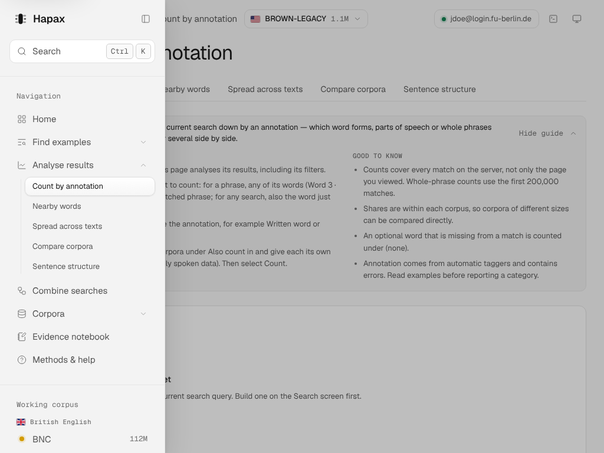
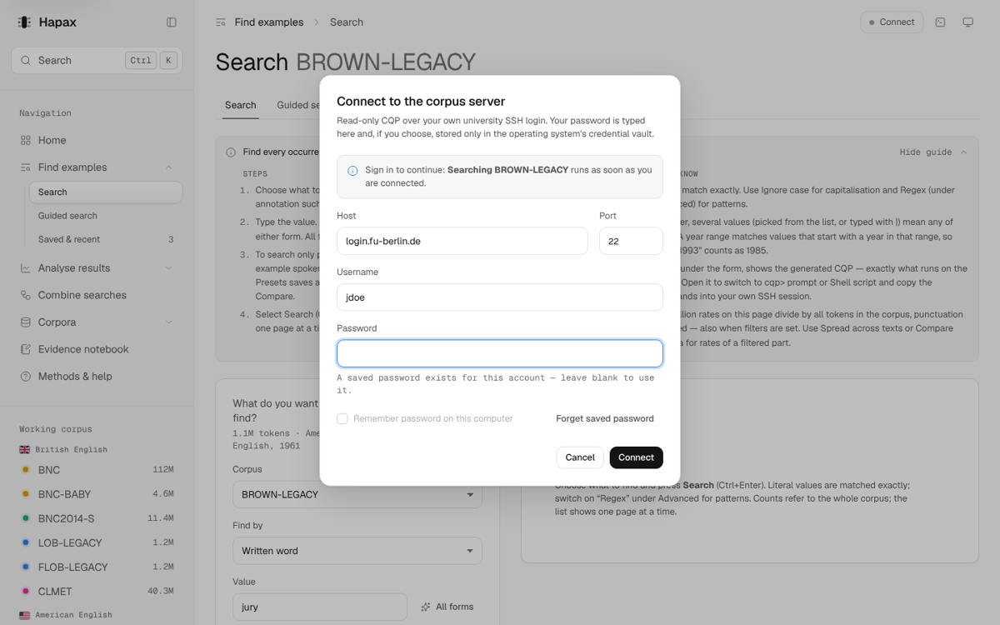
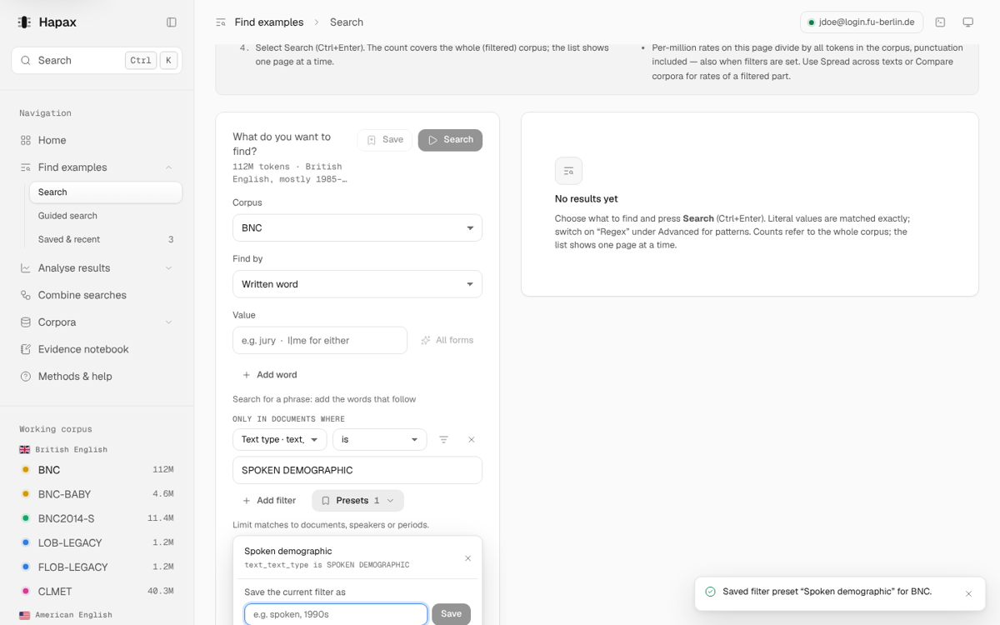
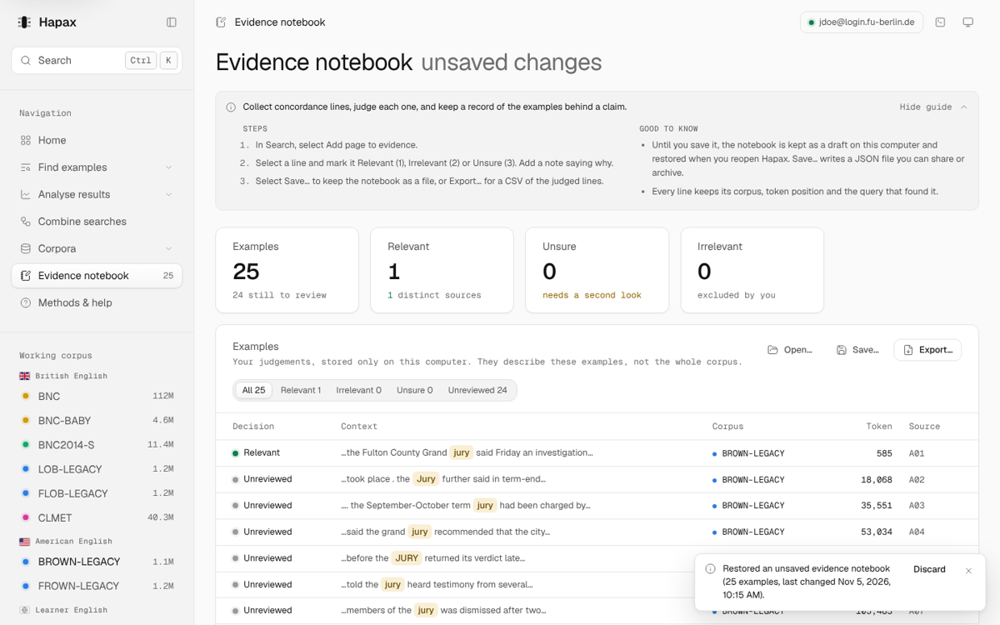

# Hapax — post-change UX re-audit and quality-of-life pass (November 2026)

Follows [the first audit](ux-audit-2026-11.md). Scope: every change in commits `21885aa` (audit fixes)
through `4a9581f` (P1–P5), re-tested as unverified, then a fresh software-wide QoL pass.

Commits from this pass: `7304232` (Stage 1 corrections), `2750d8f`, `8698a00`, `0f05bd0` (QoL).

## 1. Coverage and limitations

**Inspected:** the full diff `21885aa~1..4a9581f` (34 files). The running app in the browser
fixture backend (`?fixtures=1`, `?fixtures=offline`), every screen at 390, 1024, 1100, 1280, 1440
and 1920 px, in dark and light themes. States checked: empty, loading, results, stale,
validation error, disconnected, disabled, focus, selected, hover, menus open. Keyboard paths,
screen-reader attributes (axe-core plus manual inspection of live regions and labelling), the
regression suites, and `cargo test`.

**Not verified:**
- Behaviour against the real university server.
- Rendering in WebView2 (Windows) and WebKitGTK (Linux). `:has()` and `-webkit-line-clamp` are
  used; both are supported in current WebView2 and WebKitGTK ≥ 2.42, but neither was run here.
- Real screen-reader output. The attributes were checked; NVDA/Orca were not run.
- No user testing was done. Every score below is an assessment, not a measurement.

**Baseline:** the "before" state of each change was rebuilt from git. Positions and counts
marked *measured* come from Playwright; everything else is an estimate.

## 2. Stage 1 — verdicts on previous changes

| Item | Before → After | Finding / Evidence | Impact | Verdict | Corrective action |
|---|---|---|---|---|---|
| P5 Query panel: copy | Copy on the closed bar | Disabled whenever the remembered view was *cqp> prompt* or *Shell*, although the bar shows the CQP (measured) | High | REFINE | The closed bar always copies what it shows (the CQP) |
| P5 Query panel: peek | One-line CQP preview | `aria-live="polite"`, so every keystroke was announced; in the 420-px column only `BROWN-LEGACY; GUIQuery = [` was visible | Med | REFINE | Not a live region (errors stay `role=alert`); shows the query expression only |
| P5 validation | Error inside the panel | The field was not linked to its error; the stale notice's *Run again* stayed enabled for an invalid query (measured) | Med | REFINE | `aria-describedby` on the value field; *Run again* follows the same rules as *Search* |
| P4 rail ≤ 1100 px | Labels hidden, toggle removed | At 1024 px no way to see nav labels or sub-pages; tooltips only | Med | REFINE | The toggle opens the full sidebar as an overlay (Esc, scrim or navigation closes it; focus returns) |
| P4 corpus switcher | Top-bar switcher | Works with keyboard and focus return; on phones the page name shrank to "Sea…" beside it | Low | KEEP + REFINE | Phone top bar hides the page name visually (the page title names it) |
| P3 corpus table | 11 cards → table | Description column hidden at 1440 px with the sidebar open, the most common size; long variety notes did not wrap; "Metadata 92" unexplained; status clipped on phones | Med | REFINE | Description from 1000 px of content; variety and description wrap; "92 fields" plus a heading tooltip; wrapping on phones |
| P3 table labels | — | The two attribute tables had swapped `aria-label`s (fixed in P3) | — | KEEP | — |
| P2 Home | Chart → "continue" | Works in all three states; list-card actions sat about 5 px below their titles; the not-connected hint was cut off | Low | KEEP + REFINE | One-line card headers centre their actions (global); shorter hint |
| P1 two-column Search | Form beside results | Refine loop holds (results move 93 px, measured); Save and Search stacked vertically in the narrow column; subtitle ran to 4 lines | Low | KEEP + REFINE | Actions stay on one line; subtitle clamped to two lines with the full text on hover |
| Audit: Compare seeded from search | Current corpus + filters | **Render loop** ("Maximum update depth exceeded") when Compare opened with an empty value. Root cause: `useCqpPreview` keyed on object identity | High | REWORK | Hook keyed on content; all 14 screens swept with empty and filtered queries, online and offline: no console errors |
| Audit: learning guides | Collapse once → all collapse | Purpose line and *How it works* remain visible; Help can reset all guides | Low | KEEP | — |
| Audit: terminal disclosure | Closed by default | Superseded on Search by P5; still used in the console and Combine | — | KEEP | — |
| Audit: scroll results into view | After a search | Correct in one- and two-column layouts | — | KEEP | — |
| Design tokens | — | `.muted` (30 uses) was defined only inside tables and the Home start list, so most hints rendered at full text colour | Med | REWORK | Defined once in `base.css` (`--text-3`, 4.6:1 dark, 5.1:1 light) |
| Shell | — | No skip link: 25 tab stops before page content (measured) | Med | REWORK | *Skip to content* is the first Tab stop |
| CSS | — | An orphaned rule from the removed card graphic swallowed the `.field` rule after it (found in P5) | Med | Fixed in P5 | — |
| Repository | — | Five test screenshots committed by mistake under `undefined/` | Low | REVERT | Removed; the test script's output path now has a default |

**Retained:** P1, P2, P3, P4 and P5, each refined.
**Repaired:** the Compare render loop, the token gap, the skip link and the file hygiene.
**Reversed:** only the stray files.
**Still unverified:** WebView2/WebKitGTK rendering and real screen-reader output.

### Assessment scores (0–10, judgement, not measured)

| Screen | Clarity | Efficiency | Hierarchy | Consistency | Accessibility | Learnability | Responsive |
|---|---|---|---|---|---|---|---|
| Search (before → after this pass) | 8 → 9 | 8 → 9 | 7 → 8 | 7 → 8 | 7 → 9 | 8 → 8 | 7 → 8 |
| Home | 8 → 8 | 8 → 9 | 8 → 8 | 7 → 8 | 8 → 8 | 8 → 8 | 8 → 8 |
| Corpora → Contents | 7 → 8 | 8 → 8 | 7 → 8 | 7 → 8 | 8 → 8 | 7 → 8 | 6 → 8 |
| Shell at 1024 px | 6 → 8 | 7 → 8 | 7 → 7 | 7 → 8 | 7 → 9 | 6 → 8 | 8 → 8 |
| Evidence notebook | 7 → 8 | 7 → 8 | 7 → 7 | 7 → 8 | 8 → 8 | 7 → 8 | 7 → 7 |

## 3. Stage 1 verification

- `verify1.cjs` has one browser assertion per defect: **23/23 pass**.
- Earlier suites:
  - regression: 18/18;
  - navigation: all pass;
  - filters, features, P2, P3 and P5 scripts: pass;
  - `cargo test`: 51 pass.
- axe-core: 0 violations on 28 screen/theme views.
- Horizontal overflow: none at 390, 1024 or 1440 px.
- The Compare loop was **not** caught by the earlier suites, because they always typed a value
  first. The new sweep (`sweep.cjs`) visits every screen with empty and filtered queries, online
  and offline.

## 4. Stage 2 — QoL opportunity register

Score = Impact × Frequency × Confidence ÷ Effort (heuristic).

| # | Location | Pain point | Proposal | I | F | C | E | Score | Class | Status |
|---|---|---|---|---|---|---|---|---|---|---|
| Q1 | Evidence notebook | Judgements were lost when the app closed; the guide said "exists only in this window" | Keep an unsaved draft locally and restore it on start (Discard is undoable); saving to a file clears it | 5 | 3 | 0.9 | 2 | 6.8 | Structural | **Done** |
| Q2 | Search, Home, analyses | A search refused for lack of a connection opened sign-in, then had to be repeated; the message mentioned a non-existent "SSH panel" | Remember the refused action, name it in the dialog, run it after sign-in; Home offers *Connect and run* | 3 | 4 | 0.9 | 2 | 5.4 | Quick win | **Done** |
| Q3 | Sign-in dialog | Focus started on Host even when host and user were saved | Start in Password | 2 | 4 | 0.9 | 1 | 7.2 | Quick win | **Done** |
| Q4 | Evidence | Removing one example needed a confirmation dialog | Remove at once with Undo (position and judgement restored) | 2 | 3 | 0.9 | 1 | 5.4 | Quick win | **Done** |
| Q5 | Save search | Saving under an existing name replaced it silently | Inline warning; the button reads *Replace* | 4 | 2 | 0.9 | 1 | 7.2 | Quick win | **Done** |
| Q6 | Search, Count, Compare | The same metadata filters were rebuilt by hand in every tool | Named filter presets per corpus, Undo on apply and delete | 4 | 3 | 0.7 | 3 | 2.8 | Structural | **Done** |
| Q7 | Evidence | A failed save still marked the notebook as saved | Mark it saved only on success | 4 | 1 | 1.0 | 1 | 4.0 | Defect | **Done** |
| Q8 | Results | Only Previous/Next for long result lists | "Go to match N" | 2 | 2 | 0.6 | 2 | 1.2 | Quick win | Next |
| Q9 | Search form | An unrun query is lost on restart | Persist the form draft | 2 | 1 | 0.6 | 1 | 1.2 | Quick win | Next |
| Q10 | Presets | Stored in WebView storage, not in `preferences.json` with saved searches | Move to the Rust preferences | 2 | 1 | 0.8 | 3 | 0.5 | Structural | Next (needs a backend change) |
| Q11 | Results | Freshness ("ran 12 min ago") | — | 1 | 2 | 0.4 | 1 | 0.8 | — | **Not worth adding** (results are immutable; the stale notice covers query drift) |
| Q12 | Shell | Density setting | — | 1 | 1 | 0.4 | 3 | 0.1 | — | **Not worth adding** |

## 5. Implementation results

**Files changed in this pass:**
- `src/state/store.jsx`: toast actions, evidence draft, pending action.
- Components: `Dialogs.jsx`, `ui.jsx` (`data-autofocus`), `TerminalBlock.jsx`, `QueryBuilder.jsx` (preview hook, `errorId`), `FilterEditor.jsx`, the new `FilterPresets.jsx`, `Sidebar.jsx`, `Topbar.jsx`.
- Screens: `App.jsx`, `Search.jsx`, `Evidence.jsx`, `Overview.jsx`, `Corpus.jsx`, `Analysis.jsx`, `Workflows.jsx`.
- `guides.js`.
- Styles: `base.css`, `components.css`, `layout.css`.
- Backend: `src-tauri/src/error.rs`, wording only.

**Behaviour preserved:**
- Read-only server access is unchanged.
- No raw CQP input was added; presets store the same structured, allow-listed filters as saved searches.
- Passwords still go only to the keychain.
- The draft and the presets live in the app's local storage on this computer. The draft may contain learner or speaker text, the same as a saved notebook file. The guide states where it lives.

**Tests:**
- New scripts: `g1.cjs` (11 assertions), `g2.cjs` (8), `g3.cjs` (13).
- `axe-new.cjs`: 10 interactive states (presets menu, save dialog with a taken name, rail menu, sign-in with a pending action, restored-notebook toast), dark and light, **0 violations**.
- The full earlier suites and the sweep re-run after every group.

**Outstanding:** Q8–Q10.

## 6. Before / after

| Task | Before | After | Basis |
|---|---|---|---|
| Search while disconnected | Search → sign in → **Search again** (3 actions) | Search → sign in (2) | Measured flow |
| Resume the last search from Home while disconnected | Connect → sign in → Run again (3) | *Connect and run* → sign in (2) | Measured flow |
| Remove one evidence example | Remove → confirm (2) | Remove (1), Undo available | Measured flow |
| Reapply "spoken, 1990–1994" in Compare | Add filter, attribute, values, Add filter, attribute, from, to (~7) | Presets → choose (2) | Counted controls |
| Copy the CQP with a terminal view remembered | Impossible closed; open → switch view → copy (3) | Copy (1) | Measured |
| Reach page content by keyboard | 25 Tab stops | Tab, Enter (2) | Measured |
| See nav labels at 1024 px | Not possible (tooltips only) | 1 click | Measured |
| Closing the app with unsaved judgements | Lost | Restored on next start | Measured (reload) |

## 7. Decision log and roadmap

- **Keep:**
  - P1–P5 as refined.
  - The undo-over-confirm pattern for single, reversible removals. Bulk exports keep their confirmation.
  - The one-action toast as the shared vehicle for Undo, Discard and similar.
- **Improve next:**
  - Q8 *Go to match N*.
  - Q9 form draft.
  - Q10 presets in `preferences.json`, so they sit beside saved searches and survive a WebView reset.
  - A shared `Table` component, so sortable headers (P3) and region labels stop being repeated per screen.
  - Run the suites in CI against the fixture backend, so regressions like the Compare loop fail a build.
- **Do not add:** result freshness labels, a density setting, a second confirmation layer.
- **Needs approval:** none of the above is destructive. Q10 changes the preferences file format, which is backward compatible but touches the backend; I'd propose it before doing it.
